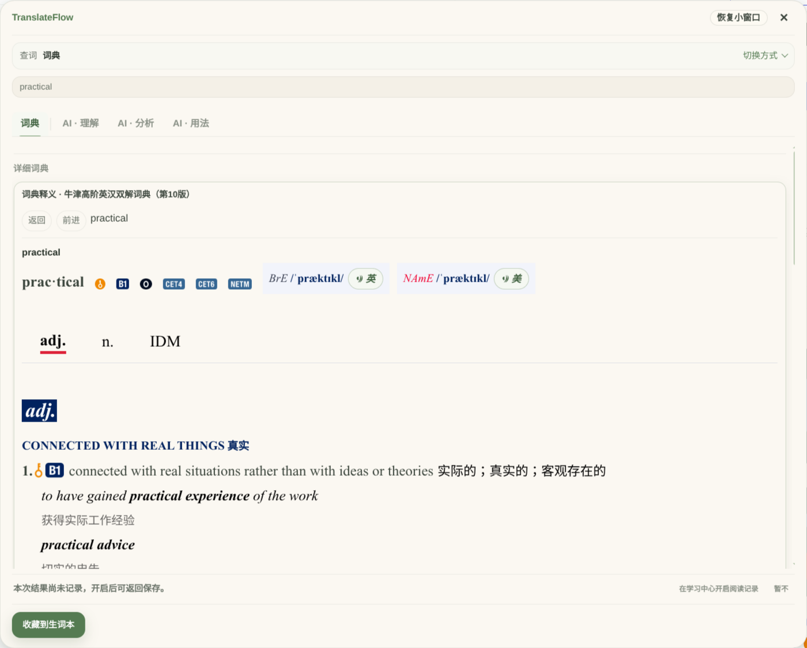
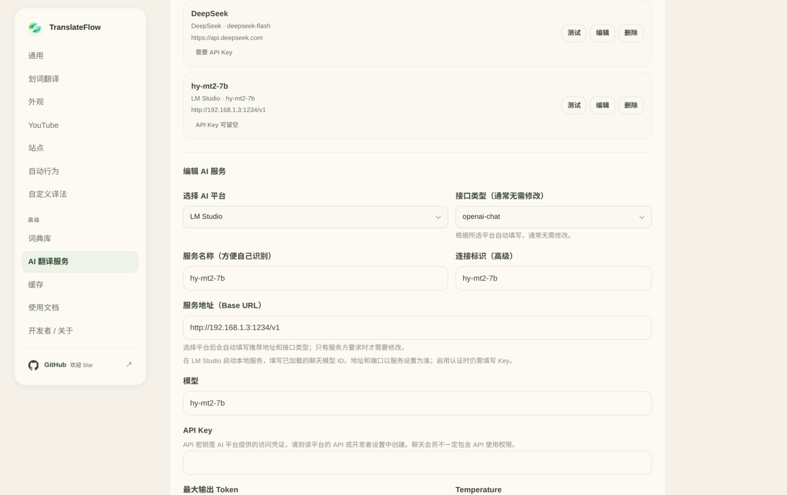

# TranslateFlow

**English** · [简体中文](README.md)

<p align="center">
  
</p>

<p align="center"><strong>Bilingual reading, selection lookup and AI text translation for the web.</strong><br />Pick your own translation service, reuse the local cache, and keep what is worth remembering.</p>

<p align="center">
  <a href="#getting-started">Getting started</a> ·
  <a href="https://coderlambert.github.io/translateflow-plugin/">Privacy &amp; support</a> ·
  <a href="https://github.com/CoderLambert/translateflow-plugin/issues">Report an issue</a> ·
  <a href="https://github.com/CoderLambert/translateflow-plugin">Star the repo</a> ·
  <a href="#author--support">Support the author</a>
</p>

TranslateFlow is a Chrome Manifest V3 translation extension. You can use your own AI service, the free online translation option, or Chrome's on-device translation where the device supports it, and you can import local dictionaries. **Word lookup and sentence/page translation are configured separately; when a method fails your choice is kept, and nothing silently switches to a paid AI service.**

## Version


`main` always carries the source version recorded in `manifest.json` and `package.json`. Every build is published as a [GitHub Release](https://github.com/CoderLambert/translateflow-plugin/releases/latest) with a ready-to-load zip. Store listings (Chrome Web Store / Edge Add-ons) will be added once review passes; the release zip is not store-signed and has to be loaded in developer mode as described under [Install](#install).

The screenshots below show the Chinese UI; the extension itself follows your browser language.

## What it does

| Feature | What you get |
| --- | --- |
| **Bilingual web reading** | Read the translation next to the original while links and code keep their structure; show/hide, cancel, retry and per-site preferences. |
| **Selection lookup and AI explanation** | Select text to see a translation or a dictionary entry; ask AI for meaning, analysis or usage only when you click for it. |
| **AI text translation** | Open a separate small window from the toolbar popup or the floating control, paste text, pick a scenario such as email or office, then copy or keep refining. |
| **YouTube subtitle help** | On videos with available captions, choose bilingual, translation-only or original mode and adjust the size; it depends on captions and the selected translation method being ready. |
| **Cache and automatic behaviour** | Enable auto translation or cache-only restore per site; cache restore never starts a translation request for missing content. |
| **Local dictionaries and learning centre** | Import compatible dictionaries, save entries, manage the reading records you enabled, and revisit saved context and results. |

## Screenshots

**Local dictionary lookup**



Screenshot provided by a user; only the browser and background page were cropped out. It shows part of the interface of *Oxford Advanced Learner's English-Chinese Dictionary* (10th edition); the text and layout remain the copyright of the respective rights holders. It is shown only to illustrate how a locally imported dictionary is rendered. No dictionary file or download authorisation is provided here, and this does not imply any partnership with the publisher. A visible pronunciation button does not mean its audio resources were verified; that depends on the imported files and their companion resources.

**Bilingual web reading**


**AI text translation window**


The bilingual reading and AI text translation screenshots come from the real extension UI, with translations produced by the local `hy-mt2-7b` model over public demo text; they do not represent every service or model. Definitions in the dictionary screenshot come from the imported dictionary.

## Install

A store listing will be added once review passes. You can build from source:

```bash
git clone https://github.com/CoderLambert/translateflow-plugin.git
cd translateflow-plugin
npm ci
npm run build:extension
```

Or download the zip from the [latest release](https://github.com/CoderLambert/translateflow-plugin/releases/latest) and unzip it into a fixed directory, which skips the build step. When GitHub is slow or unreachable, use the [China download mirror](https://git.lambert.host/translateflow/) — the same package as the release asset, verifiable with `SHA256SUMS`.

Development uses Node.js `>=24.21.0 <25` and npm `>=11.19.0 <12`.

Then open `chrome://extensions/`, enable **Developer mode**, click **Load unpacked** and select **`dist/extension/`** in the repository (or the directory you unzipped, which must contain `manifest.json` directly).

The extension ships without a full dictionary. Without an API key or dictionary you can still explore settings and the in-app guide first. Preparation requirements per translation method are listed below.

## Getting started

**1. Choose a translation method**

In **Settings → General**, choose the "word lookup method" and the "sentence and page translation method" separately, then click **Save translation preferences**.

| Method | What you need | Where your text goes |
| --- | --- | --- |
| **Your own AI service** | Service URL, exact model name and API key; local compatible services may allow an empty key and HTTP as they require. | Sent directly to the service you configured. Cloud services may charge; a local address does not guarantee the service will not forward to the cloud. |
| **Free online** | Explicit consent to send text for translation, plus any access preparation the service asks for. | The selected service; automatic mode may switch between candidates. Web endpoints can break or rate-limit. |
| **Chrome on-device** | Browser, device and language pair support, and preparing the model resources when prompted. | Translated on the device where available; model resources may be downloaded by Chrome. |
| **Local dictionary** | Download or import a compatible dictionary you have the rights to use in **Dictionary library**, then set the word method to "dictionary". | Looked up locally; only an explicit AI action sends the content that action needs. |

Configuring a new service or installing new resources never replaces the method you already saved. **A chat subscription is not API access** — check the API availability and pricing of your service before using AI.

**2. Open a page and get a first translation**

On a normal HTTP/HTTPS page, click the toolbar icon and choose "Translate this page"; you can also right-click anywhere on the page and choose "Translate or update this page"; or select text and use the lookup entry that appears. The context-menu entry reuses your saved translation method, and a new site still asks for site access the first time. After updating the extension, refresh the pages you already had open.

You can try it on this [public reading demo](https://coderlambert.github.io/translateflow-plugin/demo.html). Protected pages such as Chrome internal pages and the store cannot be injected, so use the separate AI text translation window from the toolbar instead.

**3. Adjust as needed**

- Only this site: edit the site preferences in the toolbar popup and click "Apply and translate"; the word lookup method stays global.
- Translate your own text: open **AI text translation**, pick languages, an existing AI service and a scenario, then translate with the button or `Ctrl/⌘ + Enter`; `Enter` inserts a newline.
- Keep going after a lookup: click the AI explanation explicitly; local dictionary results and AI output are always labelled with their source.
- Avoid repeated requests: enable "restore cache" for the site; it only restores cache hits and never backfills missing content.

**The complete guide lives in Settings → User guide**: switch between chapters for first-time setup, subtitles, dictionaries, the learning centre, keyboard shortcuts and troubleshooting; it works offline.

## AI services and local models

OpenAI, Anthropic, Gemini, DeepSeek and many OpenAI-compatible services are supported, and you can connect local or self-hosted services such as Ollama and LM Studio. Settings offers platform presets, and multiple connections can be saved independently with one as default.

TranslateFlow is a **BYOK client**: there is no TranslateFlow account, and services and credentials are configured by you inside the browser. After adding a default AI service you still have to select the AI translation method in General settings and save it.

The public edition does not include the experimental ChatGPT subscription bridge. That feature is limited to the separate developer build, and a chat subscription must not be used as an API credential in the public edition. See [AI service configuration](docs/PROVIDERS.md) and [developer build notes](docs/CHATGPT_DEVELOPMENT_BUILD.md).

### Recommended local model (LM Studio + `hy-mt2-7b`)

If you want to translate locally and keep page text off the cloud, load `hy-mt2-7b` in LM Studio (a 7B-class translation model with stable Chinese↔English output). Once the model is loaded and the local server is running, fill in the extension as shown:



| Field | Value |
| --- | --- |
| AI platform / API type | `LM Studio` / `openai-chat` (filled in automatically after choosing the platform) |
| Service name / connection id | Any name you recognise, for example `hy-mt2-7b` |
| Service URL (Base URL) | `http://127.0.0.1:1234/v1` on the same machine; when the extension and LM Studio run on different machines, use that machine's LAN address (for example `http://192.168.1.3:1234/v1`) |
| Model | The model identifier shown in LM Studio, for example `hy-mt2-7b` |
| API key | Leave empty; it is only needed when you enable authentication for the endpoint in LM Studio |

On the LM Studio side, set **GPU offload to the maximum**, a context length of 4K–8K and concurrency 1. For access from another machine you must explicitly enable serving on the local network and allow the port. Start Temperature around 0.2 and give the maximum output tokens enough room for the paragraph; these settings visibly change the translation style, so tune them against your own results.

Hardware guidance (7B model; real requirements vary with quantisation, context length and backend — `hy-mt2-7b` has roughly 7B parameters):

| Hardware | Recommendation |
| --- | --- |
| Discrete GPU, 6 GB VRAM | 4-bit quantisation works for short sentences; long paragraphs can exhaust VRAM, so 8 GB is the practical starting point |
| Discrete GPU, 8 GB VRAM | 4-bit / 5-bit quantisation is comfortable; enough for everyday page paragraphs (recommended) |
| Discrete GPU, 12–16 GB VRAM | 6-bit / 8-bit quantisation, more headroom for long paragraphs and longer context |
| Discrete GPU, 24 GB VRAM or more | 16-bit precision, or a much larger context |
| Apple Silicon (unified memory) | 16 GB runs 4-bit; 24 GB or more is smoother; Metal inference |
| CPU only | 8 cores and 16 GB of memory to start; clearly slower than a GPU, fine for short and occasional use |

Model files: about 4–5 GB at 4-bit, 7–8 GB at 8-bit, 14–15 GB at 16-bit. Beyond the weights, VRAM also needs room for the KV cache and inference overhead (usually another 1–2 GB). The first load takes tens of seconds; afterwards it stays resident.

Note: using a LAN address means the text you translate is sent to that machine rather than staying on your computer, and other devices on the network may be able to reach that endpoint. Decide based on your own network.

## Local dictionaries and learning records

The existing import paths cover TFLex, StarDict and MDX/MDD. The dictionary library offers pre-checks, progress, cancel, enable/disable, ordering and deletion; format, encoding and companion-resource support has boundaries, and no third-party dictionary is guaranteed to render completely.

Dictionary scripts are never executed and remote resources inside a dictionary are never loaded automatically. Large dictionaries arrive through a user-initiated download or import and do not inflate the base package.

The learning centre separates reading records, a saved-word list and minimal review. Reading records must be enabled separately; saved words, reading data and dictionaries each have their own delete or export entry. Drafts and the last 20 results of the AI text window live only in the browser session and are never added to long-term learning records automatically.

**Where to get dictionaries?**

- [FreeDict downloads](https://freedict.org/downloads/): multilingual open dictionaries; choose the StarDict format. Each dictionary may have a different licence.
- [WikDict downloads](https://www.wikdict.com/page/download): bilingual data derived from Wiktionary under CC BY-SA 4.0; check the language pair you need first.
- **MDX/MDD**: settings already lists a curated ECDICT MDX upstream, so verify its source and limits first; other dictionaries must be files the rights holder allows you to use in this reader. Public forums, cloud drives or "for study only" notes do not replace authorisation, and no commercially licensed dictionary without clear rights is recommended here.

StarDict packages must be unzipped first; in **Settings → Dictionary library → Local import** select the matching `.ifo`, `.idx`, `.dict` / `.dict.dz` and the `.syn` shipped with the package. For MDX, import the matching MDD, CSS and local resources together as prompted. These external projects do not mean every package has been verified for compatibility with this extension.

[Download, licensing and compatibility notes (Chinese)](docs/DICTIONARY_DOWNLOADS.md)

More (Chinese): [dictionary boundaries](docs/LEXICAL_DATA_BOUNDARIES.md) · [MDict compatibility](docs/MDICT_REAL_WORLD_COMPATIBILITY.md) · [learning centre](docs/LEARNING_CENTER_V1.md).

## Privacy and permissions

- No ads, no analytics and no automatic diagnostic reports to the maintainer; online translation still sends the relevant text and necessary context to the service you chose.
- Settings, cache, dictionaries and learning data are stored on your device. API keys live in extension local storage; this is not a separately encrypted password vault.
- Access to ordinary web pages is used to start selection, the floating control and the translation features you enabled; that access does not mean everything you browse is uploaded. You can restrict site access in Chrome.
- Cache restore never calls a service to fill gaps; enabling automatic translation may produce network requests and service charges.
- You can withdraw the free-online consent, disable per-site automatic behaviour, pause reading records, and clear cache, dictionary and learning data separately.

[Privacy policy](https://coderlambert.github.io/translateflow-plugin/privacy.html) · [隐私政策（中文）](https://coderlambert.github.io/translateflow-plugin/privacy-zh-CN.html) · [Support page](https://coderlambert.github.io/translateflow-plugin/support.html)

Policies, support and third-party licences are also available offline in **Settings → About**. Data retention, pricing and processing rules of external services are governed by their own policies.

## Reporting issues

Read the in-app guide first, or the [help and recovery steps (Chinese)](docs/SUPPORT.md). If that does not help, open a [GitHub issue](https://github.com/CoderLambert/translateflow-plugin/issues) with the version, browser, feature entry point, translation method, reproduction steps and error message.

Before posting publicly, remove API keys, private URLs, page content and unredacted screenshots. Do not start troubleshooting by uninstalling the extension or clearing all data.

## Contributing

Production builds use WXT; extension pages use React, while Content, Background, MAIN and Worker keep their own runtime boundaries. Development and acceptance commands come from the repository scripts:

```bash
npm run check
npm run typecheck
npm test
npm run test:unit
npm run build:extension
```

Browser tests use an isolated temporary profile and mock services, so no private API key is needed. `npm run validate` combines static checks, Node tests, type checks, Vitest and the build; it does not include the browser E2E suite.

- [Contributing and development flow (Chinese)](CONTRIBUTING.md)
- [Architecture and module boundaries (Chinese)](docs/ARCHITECTURE.md)
- [Browser E2E (Chinese)](docs/E2E.md)
- [Cache and data compatibility (Chinese)](docs/CACHE_SYSTEM.md)

## Author & support

TranslateFlow is developed and maintained by [CoderLambert](https://github.com/CoderLambert), who is now on Afdian.

**Afdian page: [https://afdian.com/a/transflow](https://afdian.com/a/transflow)**

This repository showcases and maintains TranslateFlow; the Afdian page above is operated by the author and accepts voluntary support for continued development, polish and day-to-day maintenance.

<a href="https://afdian.com/a/transflow"></a>

Scanning the code or following the link opens the Afdian page; confirm the amount and support period on the platform before paying. Support is entirely voluntary, does not affect any feature and does not include third-party AI quotas. Using the extension, reporting issues or sharing it with friends supports the project just as well.
