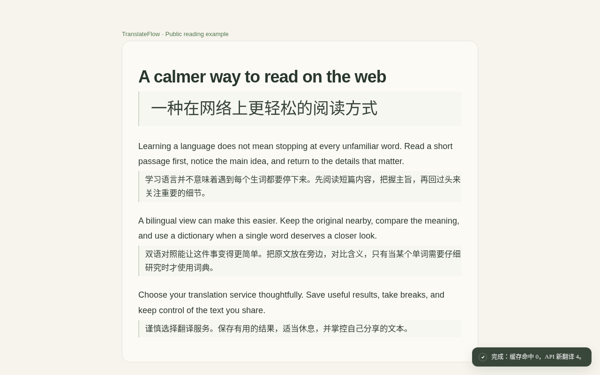
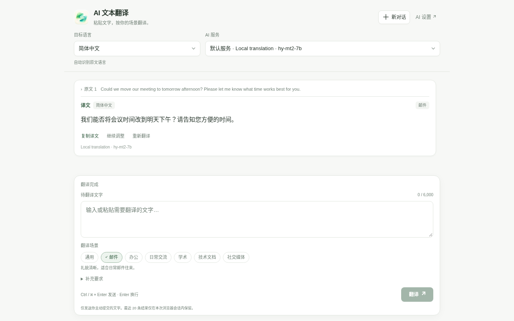

# TranslateFlow v0.8.62

<p align="center">
  
</p>

<p align="center"><strong>网页双语阅读、划词查询与 AI 文本翻译。</strong><br />选择自己的翻译服务，复用本地缓存，把值得记住的内容留下来。</p>

<p align="center">
  <a href="#开始使用">开始使用</a> ·
  <a href="https://coderlambert.github.io/translateflow-plugin/">隐私与支持</a> ·
  <a href="https://github.com/CoderLambert/translateflow-plugin/issues">反馈问题</a> ·
  <a href="https://github.com/CoderLambert/translateflow-plugin">欢迎 Star</a> ·
  <a href="#请我喝杯咖啡">支持作者</a>
</p>

TranslateFlow 是 Chrome Manifest V3 翻译扩展。你可以使用自己配置的 AI 服务、免费在线翻译，或设备支持的 Chrome 本地翻译，也可以导入本地词典。**单词查词与句段／全文翻译分别选择方式，失败时保留你的选择，不会悄悄切换到付费 AI。**

## 能做什么

| 功能 | 使用体验 |
| --- | --- |
| **网页双语阅读** | 对照原文阅读译文，保留链接和代码等结构；支持显隐、取消、重试与站点偏好。 |
| **划词查询与 AI 解读** | 选中文字查看译文或词典结果；需要理解、分析或用法时，再主动调用 AI。 |
| **AI 文本翻译** | 从工具栏弹窗或悬浮球打开独立小窗，输入或粘贴文字，选择邮件、办公等场景，复制或继续调整译文。 |
| **YouTube 字幕辅助** | 在有可用字幕的视频中使用双语、仅译文或原文模式，调整字号；依赖视频字幕及所选翻译方式就绪。 |
| **缓存与自动行为** | 按站点开启自动翻译或仅恢复已有译文；缓存恢复不为缺失内容自动发起翻译请求。 |
| **本地词典与学习中心** | 导入兼容词典，收藏词条、管理已启用的阅读记录，回顾保存的语境和结果。 |

## 看看效果

**网页双语阅读**



<details>
<summary>查看 AI 文本翻译小窗</summary>



</details>

以上为实际扩展界面，译文来自本地 `hy-mt2-7b` 模型与公开演示文字，不代表所有服务或模型的翻译效果。

## 安装

商店安装链接会在正式上线后补充。目前可从源码构建：

```bash
git clone https://github.com/CoderLambert/translateflow-plugin.git
cd translateflow-plugin
npm ci
npm run build:extension
```

开发环境使用 Node.js `>=24.21.0 <25`、npm `>=11.19.0 <12`。

然后打开 `chrome://extensions/`，开启「开发者模式」，点击「加载已解压的扩展程序」，选择仓库内的 **`dist/extension/`**。

扩展不内置完整词典；没有 API Key 或词典也可以先查看设置和使用文档。不同翻译方式的准备要求见下文。

## 开始使用

**1. 选择翻译方式**

在「设置 → 通用」分别选择「单词查词方式」与「句段与全文翻译方式」，点击 **「保存翻译偏好」**。

| 方式 | 需要准备什么 | 数据发送到哪里 |
| --- | --- | --- |
| **自选 AI 服务** | 服务地址、准确模型名称和 API Key；本地兼容服务可按其要求允许空密钥与 HTTP。 | 直接发送给你配置的服务。云端可能收费；本地地址不保证服务不会再转发云端。 |
| **免费在线** | 明确同意发送待翻译文本；按提示完成服务访问准备。 | 所选服务；自动模式可能在候选服务间切换。网页接口可能失效或限流。 |
| **Chrome 本地** | 浏览器、设备和语言对支持，并按提示准备模型资源。 | 可用时在设备上翻译；模型资源可能由 Chrome 下载。 |
| **本地词典** | 在「词典库」下载或导入有权使用的兼容词典，启用后将单词方式设为「词典」。 | 本地查询；单独点击 AI 功能才发送该操作需要的内容。 |

配置或安装新资源不会自动替换你已保存的翻译方式。**聊天会员不等于 API 权限**，使用 AI 前请确认相应服务的 API 可用性与费用。

**2. 打开网页，得到第一份译文**

在普通 HTTP/HTTPS 网页点击工具栏图标，选择「翻译当前页」；也可以选中文字，点击出现的查询入口。更新扩展后，先刷新原来的网页。

可以用这篇[公开阅读示例](https://coderlambert.github.io/translateflow-plugin/demo.html)试用。Chrome 内部页、商店页等受保护页面无法注入页面翻译，可从工具栏打开独立的 AI 文本翻译窗口。

**3. 按需要调整**

- 只调整当前网站：在工具栏弹窗编辑本站偏好，点击「应用并翻译」；单词方式仍由全局设置管理。
- 翻译自己的文字：打开「AI 文本翻译」，选择语言、已有 AI 服务与场景，点击翻译或按 `Ctrl/⌘ + Enter`；`Enter` 用于换行。
- 查词后继续理解：明确点击 AI 解读；本地词典结果与 AI 输出会分别标明来源。
- 想节省重复请求：开启本站「自动恢复缓存」；它只恢复命中，不自动补翻。

**完整指引在「设置 → 使用文档」**：按功能切换章节，包含首次配置、字幕、词典、学习中心、快捷键与问题排查；无需联网即可查阅。

## AI 服务与本地模型

支持 OpenAI、Anthropic、Gemini、DeepSeek，以及多种 OpenAI-compatible 服务；也可连接 Ollama、LM Studio 等兼容的本地或自托管服务。设置页提供平台预设，多连接可独立保存并选择默认服务。

TranslateFlow 是 **BYOK 客户端**：无需注册 TranslateFlow 账号，服务与凭据由用户在浏览器中自行配置。添加默认 AI 服务后，仍需在通用设置选择 AI 翻译方式并保存。

公开版不提供实验性的 ChatGPT 订阅本地连接。该功能仅面向独立开发版，不能将聊天订阅当作公开版 API 使用凭据。详见 [AI 服务配置](docs/PROVIDERS.md)与[开发版说明](docs/CHATGPT_DEVELOPMENT_BUILD.md)。

## 本地词典与学习记录

可按已有导入路径使用 TFLex、StarDict、MDX/MDD。词典库提供预检、进度、取消、启停、排序与删除；格式、编码和伴随资源的支持存在边界，不承诺任意第三方词典都能完整显示。

词典脚本不会执行，词典内的远程资源不会自动加载。大型词典通过用户主动下载或导入提供，不占用基础安装包。

学习中心区分阅读记录、生词本与最小复习。阅读记录需要单独启用；收藏、阅读数据和词典有各自的删除或导出入口。AI 文本小窗的草稿及最近 20 条结果仅保留在浏览器会话中，不会自动加入长期学习记录。

更多说明：[词典边界](docs/LEXICAL_DATA_BOUNDARIES.md) · [MDict 兼容性](docs/MDICT_REAL_WORLD_COMPATIBILITY.md) · [学习中心](docs/LEARNING_CENTER_V1.md)。

## 隐私与权限

- 不内置广告、使用分析或向维护者自动发送诊断报告；在线翻译仍会把相应文字和必要上下文发送给所选服务。
- 设置、缓存、词典和学习数据分别保存在本机。API Key 保存在扩展本地存储中，不是额外加密的密码保险库。
- 普通网页访问权限用于启动划词、悬浮控件和已启用的翻译功能；访问权限本身不代表上传所有浏览内容。可在 Chrome 中限制站点访问。
- 自动恢复缓存不调用服务填补缺失；开启自动翻译则可能产生网络请求与相应服务费用。
- 可撤回免费在线同意、关闭站点自动行为、暂停阅读记录，并分别清理缓存、词典和学习数据。

[中文隐私政策](https://coderlambert.github.io/translateflow-plugin/privacy-zh-CN.html) · [Privacy policy](https://coderlambert.github.io/translateflow-plugin/privacy.html) · [支持页面](https://coderlambert.github.io/translateflow-plugin/support.html)

政策、支持与第三方许可也可在「设置 → 关于」离线查看。外部服务的数据保留、收费与处理规则由其自身政策决定。

## 反馈问题

先查看扩展内的使用文档，或阅读[帮助与恢复步骤](docs/SUPPORT.md)。仍无法解决时，在 [GitHub Issues](https://github.com/CoderLambert/translateflow-plugin/issues)说明版本、浏览器、功能入口、翻译方式、复现步骤与错误提示。

公开反馈前，请移除 API Key、私人网址、页面内容和未脱敏截图。不要通过卸载扩展或清空全部数据作为第一步排查。

## 参与开发

生产构建使用 WXT；扩展页面使用 React，Content、Background、MAIN 和 Worker 保持各自的运行边界。开发和验收命令以仓库脚本为准：

```bash
npm run check
npm run typecheck
npm test
npm run test:unit
npm run build:extension
```

浏览器验证使用隔离的临时配置和 mock 服务，不需要私人 API Key。`npm run validate` 组合静态检查、Node 测试、类型检查、Vitest 和构建，不包含浏览器 E2E。

- [贡献与开发流程](CONTRIBUTING.md)
- [架构与模块边界](docs/ARCHITECTURE.md)
- [浏览器 E2E](docs/E2E.md)
- [缓存与数据兼容](docs/CACHE_SYSTEM.md)
- [GitHub Pages 维护](docs/PAGES.md)

## 请我喝杯咖啡

如果 TranslateFlow 让阅读、翻译或查词更方便，欢迎请我喝杯咖啡，支持后续维护。☕

**[去爱发电支持作者](https://afdian.com/a/transflow)**

<a href="https://afdian.com/a/transflow"></a>

扫码或点击链接会打开爱发电主页，请在平台确认金额和支持周期后再付款。赞赏完全自愿，不影响任何功能，也不包含第三方 AI 额度。使用、反馈问题或分享给朋友，同样是在支持这个项目。
