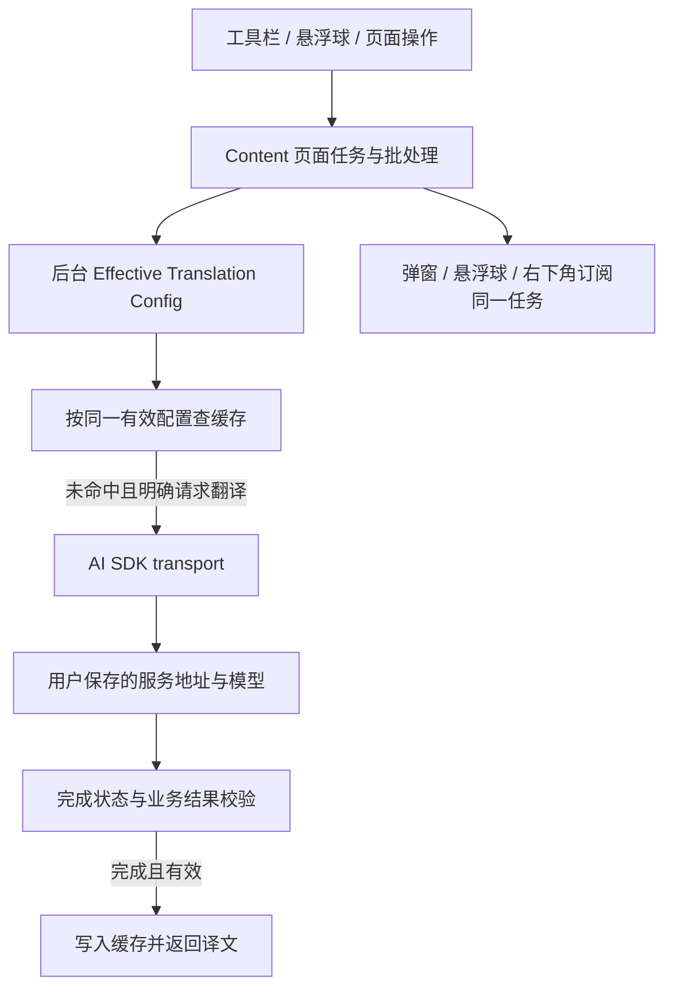

# AI SDK Provider 迁移、默认推理与网页进度方案

状态：已实现并随 [v0.8.73](https://github.com/CoderLambert/translateflow-plugin/releases/tag/v0.8.73) 发布。本文记录最终采用的方案；配置操作与精确模型参数表见 [AI 服务配置](../PROVIDERS.md#ai-sdk-与推理设置)，实施证据见[任务验收](../tasks/ai-sdk-providers/validation-report.md)。

## 目标与范围

现有全部 19 个 API Key 平台统一交给 AI SDK 处理请求协议、鉴权与流式解析。TranslateFlow 继续负责翻译任务、提示词、配置、重试、缓存和结果校验。用户仍使用自己保存的地址、模型和 API Key 直连服务商，SDK 仅进入后台构建。

本轮同时交付默认推理体验、已有页面兼容修复，以及工具栏弹窗／悬浮球／右下角页面提示的进度同步。机器翻译、Chrome 本地翻译和开发版 ChatGPT 订阅通道保持独立；权限与 CSP 不扩大。

## Provider 与协议选择

固定 `ai@7.0.170` 及 `package.json`、`package-lock.json` 中匹配的 Provider 版本。默认平台映射如下；最终选择同时取决于**保存的协议**，不依赖 SDK 的默认模型入口切换接口。

| 平台 | SDK Provider 与协议 |
| --- | --- |
| OpenAI | `@ai-sdk/openai`，显式 `.chat()` 或 `.responses()` |
| Azure OpenAI v1 | `@ai-sdk/azure`，显式 Chat／Responses，使用 v1 地址 |
| Anthropic / Claude | `@ai-sdk/anthropic`，Messages |
| Google Gemini | `@ai-sdk/google`，Generate Content |
| DeepSeek | `@ai-sdk/deepseek`，Chat |
| Groq | `@ai-sdk/groq`，Chat |
| Mistral | `@ai-sdk/mistral`，Chat |
| 阿里云百炼 / 通义千问 | `@ai-sdk/alibaba`，Chat |
| Moonshot / Kimi | `@ai-sdk/moonshotai`，Chat |
| OpenRouter | `@openrouter/ai-sdk-provider`，Chat |
| xAI / Grok | Chat 使用 `@ai-sdk/openai-compatible`；Responses 使用 `@ai-sdk/xai` |
| SiliconFlow | `@ai-sdk/openai-compatible`，厂商参数单独映射 |
| 智谱 | `@ai-sdk/openai-compatible`，厂商参数单独映射 |
| 火山方舟 / 豆包 | `@ai-sdk/openai-compatible`，厂商参数单独映射 |
| Ollama | 保存的 Chat 协议使用 compatible，保留本地免 Key 配置 |
| Ollama Cloud | 保存的 Chat 协议使用 compatible |
| LM Studio | 保存的 Chat 协议使用 compatible，保留本地免 Key 配置 |
| 本地 / 自托管 | 保存的 Chat 协议使用 compatible，保留地址与免 Key 配置 |
| 自定义 | 保存的 Chat 协议使用 compatible，保留地址与免 Key 配置 |

用户保存为 Messages 或 Gemini 协议时分别选择对应 Provider；保存为 Responses 时选择 OpenAI、Azure 或 xAI 的 Responses 实现。协议优先级由 [`sdkModel`](../../src/background/providers/ai-sdk-transport.js) 统一执行，完整接口地址也保留。兼容协议只是请求格式，请求目标仍是用户配置的厂商地址。

## 默认模型与推理取舍

**模型始终是所选连接里保存的模型。** 快速与增强预设只决定该模型的推理参数，不自动换模型、连接或服务商。

| 用户选择 | 实际行为 | 取舍 |
| --- | --- | --- |
| 快速翻译（默认） | 对已适配的精确平台／协议／模型使用关闭思考或较低档位；其他情况沿用服务商默认 | 适合日常网页阅读，优先减少推理等待；真实速度和费用仍由服务与模型决定 |
| 增强推理 | 仅在有明确模型映射时显示，使用该模型的常规档位或预算 | 复杂内容可主动尝试，可能增加延迟和 token；不保证译文一定更好 |
| 模型默认 | 不发送额外推理参数 | 跟随服务商策略；其行为可能随厂商更新变化 |
| 自定义 | 使用该平台支持的强度、预算或开关，并执行共享校验 | 面向主动调整参数的用户；未知模型仍明确标注未验证 |

默认折叠推理选项，用户配置连接后即可使用，无需先阅读模型文档或勾选确认。未知模型、自定义 Chat 网关和未知 Azure 部署别名不按名称前缀猜测能力，不显示未适配的增强预设。

具体映射由 [`provider-reasoning.js`](../../src/shared/provider-reasoning.js) 单一维护，UI、后台发送及缓存身份共同使用。例如 OpenAI 按精确模型选 minimal／none／low，增强为 medium；适配的 Claude 使用关闭思考／1024 token 预算；Gemini 2.5 按模型选择关闭或最低预算／动态预算；DeepSeek 和 Kimi 使用各自开关。完整模型名单见 [Provider 配置](../PROVIDERS.md#ai-sdk-与推理设置)，不把不同厂商的参数当成同一个「强度」。

旧显式字符串幂等规范化为 `{ mode: "effort", effort }`；旧强度、预算与开关保留。空值和 `mode: "default"` 使用快速预设，`mode: "model-default"` 才表示原生默认。SDK 不支持、忽略或降级所选参数时返回明确配置错误；用户可选回快速翻译或模型默认恢复。Claude 思考预算至少 1024，且须小于输出 token 上限。

## 调用、完成与缓存边界

- 保留 `translateBatch`、`completeJson`、`completeText`、`test` 接口，传输层内部调用 `generateText`／`streamText`。提示词、段落 ID、受保护内容和 JSON 业务校验继续复用；被替代的手写协议与 SSE 解析移除。
- SDK `maxRetries: 0`；既有外层策略统一负责 429、退避、重试次数、超时和取消，沿用 MV3 生命周期管理。流式中间文本只作进度，不作为已完成结果持久化。
- SDK 结束状态、必要的原始结束元数据与业务校验均通过后才缓存。截断、拒答、工具调用、空结果、断流及取消不能报告翻译成功；晚到结果不得覆盖当前任务。
- 保存连接时继续使用 revision，保留连接 ID、凭据、站点引用与用户地址。有效推理参数、Temperature、输出上限进入既有缓存身份；新增 `providerAdapterVersion: ai-sdk-v1` 和 `reasoningPolicyVersion: translation-presets-v1` 隔离结果。映射策略变化时更新策略版本，不靠清空数据处理兼容。
- 数据库版本不变，机器翻译与订阅通道缓存身份保持原路径。本站自动恢复缓存仍只恢复命中，未命中不隐式发请求。

主要实现入口：[`ai-sdk-transport.js`](../../src/background/providers/ai-sdk-transport.js)、[`provider-connections.js`](../../src/shared/provider-connections.js)、[`translation-cache-identity.js`](../../src/shared/translation-cache-identity.js)。

## 网页覆盖与进度同步

正文提取兼容语义 span、混合节点、长段落与多根节点，保留正文／更广页面范围选择。动态重绘后回填已有译文；同页锚点跳转保持任务，真实导航取消旧任务，同页并发批次按各自请求消费与取消。

进度只来自现有 Content page task：

- 工具栏弹窗展示阶段、完成／总数、服务信息与取消操作；关闭重开查询当前页最新任务，不再次请求翻译。
- 悬浮球与弹窗读取同一任务，旧页面和划词任务不会冒充当前页面任务。
- 页面右下角从排队阶段开始展示进度卡，任务运行期间保持可见；关闭弹窗或隐藏悬浮球不影响显示。完成、失败和实际取消后显示终态，再延时收起。
- 卡片复用 Shadow DOM UI host，与默认悬浮球错开，支持暗色及减少动画。页面重绘移除卡片后可重新挂载；旧任务计时器与晚到回调不能隐藏或覆盖新任务。

页面提示由 [`page-progress.js`](../../src/content/ui/page-progress.js) 订阅任务，不新增第二套后台任务、Provider 请求或持久化状态。详细证据见[页面兼容](../tasks/ai-sdk-providers/page-regression-report.md)、[Popup 进度](../tasks/ai-sdk-providers/popup-progress-report.md)和[右下角进度](../tasks/ai-sdk-providers/page-progress-report.md)。

## 验证与发布边界

实现候选为 `0a6924f3a3569be21aa6941a3e7282339863e846`；PR [#380](https://github.com/CoderLambert/translateflow-plugin/pull/380) 合入实现，PR [#381](https://github.com/CoderLambert/translateflow-plugin/pull/381) 完成版本化归档。v0.8.73 发布基线为 `5e6b63130a191320899218ca254902c7b67f45eb`。验收保留原候选绑定，不将文档归档视为重新运行产品测试。

| 检查 | 已有结果与限制 |
| --- | --- |
| 全部平台请求契约与完成态 | mock 覆盖地址、鉴权、模型、协议、参数，以及本地免 Key、Azure v1、xAI Chat、自定义完整端点等边界 |
| 静态、Node、类型与单元测试 | 首次 `npm run validate` 在 Node 阶段有 4 个旧 fixture 失败，修复后相关 30 项通过；其余 2316 项有效结果复用。严格类型检查、16 文件／99 项 Vitest、生产构建通过，未将首次 validate 标记为 PASS |
| Chromium/MV3 | 临时 profile 与 mock 验证配置保存、重载、后台重启、缓存隔离、完成／取消及进度同步；用户给定的 LangChain 公开页面 mock 翻译覆盖 41/41 单元与 12/12 长正文 |
| 发布产物 | v0.8.73 包共 147 文件；除 manifest 版本外，146 个运行资产与已验收包字节一致；SDK 仅进入后台，权限与 CSP 未扩大 |
| GitHub 与镜像 | v0.8.73 ZIP 为 1,465,382 字节；GitHub 附件、镜像固定版本和 latest 包均已下载核对，版本与 SHA-256 相同 |
| 未验证 | 真实付费厂商调用、延迟、费用和翻译质量；用户日常 Chrome 手工签收；商店发布 |

v0.8.73 ZIP 的 SHA-256 为 `2838b7ae516577c1471a71fd990c2e0cad6523d452e4a37e424bea36552c729e`。后续源码提交按仓库约定更新版本和构建，**不会自动改写已发布的 Release 或镜像安装包**。镜像随新 Release 发布同步，流程见 [国内下载镜像](../MIRROR.md)。

规范与外部协议依据集中在 [Provider 配置](../PROVIDERS.md#ai-sdk-与推理设置)，依赖的实际版本以锁文件为准；本文中的验证记录不代表所有厂商当前在线可用性。
