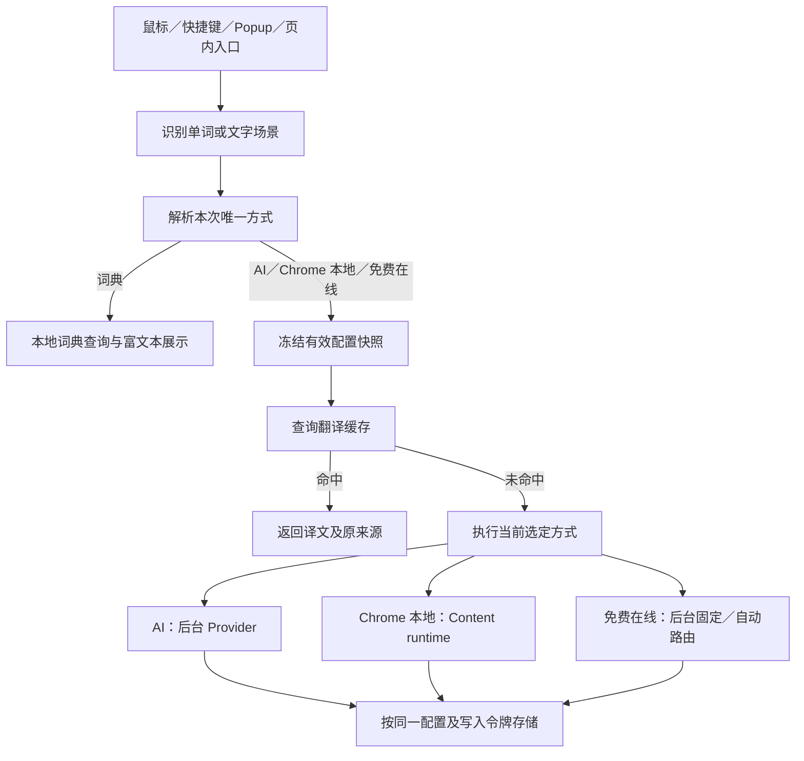

# 翻译方式与免费在线路由的方案及实现记录

本文汇总此前连续完成的免费在线路由、翻译偏好、Popup／Options 和划选面板方案，说明最终行为、对应实现及验收边界。本文是实现说明，不替代各任务合同，也不把历史阶段的设计当成当前产品规则。

记录日期：2026-10-20。本文仅在本地新增，未提交、未推送。

## 1. 实现范围与合入版本

本轮代码已通过 [PR #365](https://github.com/CoderLambert/translateflow-plugin/pull/365) squash 合入 main，版本为 **0.8.42**。

| 绑定对象 | SHA |
| --- | --- |
| 开发基线 | `49fb4ed7dcbdc49684d79803e0640b2b9fa093c0` |
| 最终实现与测试候选 | `e6db041b17e434c46b2fa4b8efdfd2625314ca83` |
| 验收归档／PR 同步提交 | `ced284d8d59e1abfbedcf9b46b33c1a71623c995` |
| 实际 main 合入提交 | `8c2b8ec0f65b7afc30be5065c49619b16b2872ea` |

合入提交的 Git tree 与验收归档提交一致。代码合入、安装目录更新和原 Chrome 实例重载是三个不同结果：前两项已完成，原浏览器重载仍需用户手动操作。没有发布商店版本或创建 release/tag。

## 2. 方案如何演变

| 阶段 | 当时要解决的问题 | 最终保留或调整 |
| --- | --- | --- |
| 免费在线 v2 路由 | 免费服务失败后可在同类服务内换线，缓存必须记住实际服务 | 保留自动／固定服务、冷却、预算、并发、来源和写入围栏 |
| 初版设置简化 | Popup／Options 重复设置、应用顺序不清晰 | 保留草稿与已保存值分离、渐进展开、唯一主按钮、先授权再保存和翻译 |
| 单词与文字分别单选 | 词典优先、浏览器启用、旧模式等多个开关竞争路由 | 新增唯一 `translationPreferences`；原「AI／浏览器本地」组合模式退出新版方法选择 |
| 划选面板优化 | 两个下拉框和常驻说明挤占结果，临时／长期设置难懂 | 改为一行当前方式，展开后直接选方式重试；纠正识别与默认设置放在展开区 |

早期文档中的 `legacy`、词典优先和「仅本次使用」按钮属于历史实现描述。当前行为以本文及 [Provider 规范](../../PROVIDERS.md#翻译偏好与执行方式) 为准；早期合同和失败记录保留，未被改写为最终通过证据。

## 3. 最终产品规则

### 3.1 两类用途，各保存一种方式

| 场景 | 可选方式 | 首次初始化 | 网站覆盖 |
| --- | --- | --- | --- |
| 单词查词 | 免费在线、词典、Chrome 本地、AI | 免费在线 | 不允许覆盖单词方式 |
| 短语、句子、段落、全文 | AI、Chrome 本地、免费在线 | 完整 AI 配置 → 明确就绪的 Chrome 本地 → 免费在线 | 可覆盖 `textMethod` |

鼠标划选、快捷键、Popup 和页内按钮是入口，不各自保存一套方法。短语归文字翻译；单词及中日文短词识别复用现有规则，并允许用户显式纠正识别。

默认顺序只在初始化时使用。之后导入／启用词典、补全 AI 配置或准备本地模型，都不重新选择方式。

选词典只查询词典；选 AI、Chrome 本地或免费在线时，不先查询词典。所选方式未命中、未就绪或失败时保留选择，显示原因；跨方式切换必须由用户明确操作。字幕继续使用已有独立路径；理解、分析和用法仍是明确点击触发的 AI 操作。

### 3.2 临时切换与长期选择

划选面板的方式选择只修改当前选区任务的 `temporaryMethod`；识别纠正同时提交本次 `selectionKind`。新选区恢复保存方式。一次 Chrome 本地重试不改变后续 AI、在线或不同场景任务。

「修改默认方式」打开设置页，不立即把当前临时方式写成默认值。长期偏好必须在设置页明确保存。

结果来源显示为「词典释义 · 词典名」「在线译文 · 服务名」「Chrome 本地译文」或「AI 译文」。缓存命中沿用原来源；免费在线自动计划不是名为 auto 的真实供应商。

### 3.3 联网确认与权限

默认选中免费在线只代表选择方式，不代表同意上传。执行前校验匹配当前自动／固定设置的联网确认和服务 origin 权限；缺失时先提示，拒绝后不联网、不跨方式备用。

界面读取、展开、切换未提交草稿、纠正识别和打开设置不会发起翻译请求。Popup 的主按钮按授权 → 保存本站选择 → 翻译的顺序执行；授权被拒绝或保存失败时不继续翻译。

## 4. 配置、消息与迁移

### 4.1 唯一方法配置

以下是配置关系示意，省略凭据、语言和其他现有字段：

```json
{
  "translationPreferences": {
    "version": 1,
    "wordMethod": "free-online",
    "textMethod": "ai"
  },
  "siteProfiles": {
    "https://example.com": {
      "textMethod": "browser-local"
    }
  }
}
```

`translationPreferences.version` 与免费服务参数 `machineTranslation.version` 是两个不同版本号。前者定义两类方法；后者的 v2 字段继续保存在线服务的 `routing`、`providerId`、`sourceLanguage` 等参数。旧 `machineTranslation.mode` 保留兼容，不再独立决定新版方法。

`selectedTranslationMethod()` 集中执行：有效临时方法优先；单词取全局 `wordMethod`；文字取网站 `textMethod`，无覆盖时取全局 `textMethod`。类型与方法组合均校验，文字不能临时选择词典。

### 4.2 读取与保存

- `TRANSLATION_PREFERENCES_GET`／`SAVE` 集中进入后台，沿用可信 Popup／Options 页面校验。
- 全局保存同时校验两类方法及关联服务参数；网站保存不接受单词方式或整份全局偏好。
- AI 配置完整性、目标语言、在线参数和用户已确认时的权限分别校验；不能靠保存界面绕过执行校验。
- Content 只取得执行所需的公开设置和快照标识，不取得 Provider 凭据。
- 旧 `MACHINE_TRANSLATION_SAVE` 入口返回 `PREFERENCES_REOPEN`，提示重新打开设置，避免旧页面写出冲突状态。

实现入口：[纯配置合同](../../../src/shared/translation-preferences.js)、[后台初始化与保存](../../../src/background/translation-preferences.js)、[消息路由](../../../src/background/router.js)、[公开设置](../../../src/background/public-settings.js)。

### 4.3 一次性初始化与旧配置迁移

初始化检查 AI 配置完整性，不发送连接测试。只有 AI 不完整时才探测 Chrome 本地：对已有授权页面调用 `Translator.availability()` 和 `LanguageDetector.availability()`，两者明确 `available` 才计为就绪。探测超时、未知、缺权限或不可用均回到在线默认；不创建模型、不触发下载。

初始化写入前重读配置，避免覆盖同时发生的显式选择；已有偏好时直接校验并返回，不因资源变化重新迁移。

网站迁移保留原 profile 的其他字段，并映射明确选择：

| 原网站选择 | 新文字方式 |
| --- | --- |
| 明确免费在线 | `free-online` |
| 明确 AI service/provider | `ai` |
| 明确 legacy | 按其原 AI／本地实际选择映射 |
| 没有明确选择 | 不生成覆盖，跟随全局默认 |

词典、凭据、语言、Prompt、网站其他设置及缓存不清空。独立的词典启停、本地模型准备和 AI 连接仍用于资源管理。

授权迁移有明确边界：此前通过旧确认流程保存的 **v2 免费在线设置**可以迁移对应确认记录；新默认本身不产生确认。旧免费设置 version 1 在在线参数层规范化为 v2 默认值，与整套方法偏好的初始化分开处理。

## 5. 执行、缓存与取消



词典使用已有独立词典查询和存储通道，不被强行并入翻译 DB4。

### 5.1 有效配置快照

方法、站点覆盖、语言、Provider 等解析为同一份有效配置。缓存读取、实际翻译和缓存写入使用这一快照，避免换方式后把结果写进旧身份。

快照包含配置 revision 和页面 URL；免费在线快照另校验 tab／frame／document 归属。偏好变化使相关任务取消、旧快照失效；导航、关闭浮层或选区变化后，旧请求不能覆盖新结果。重试、requestId、generation 和取消继续复用现有协调器，没有在 UI 新建任务框架。

关键代码：[有效配置](../../../src/background/config.js)、[快照生命周期](../../../src/background/effective-config-snapshots.js)、[翻译协调器](../../../src/background/cache/translation-coordinator.js)、[缓存消息适配层](../../../src/background/cache/message-handler.js)。

### 5.2 Chrome 本地句段

单词继续使用已有共享模型 Port；短语、句子、段落和网页文字走 Content 本地 runtime。通过现有语言检测、语言对准备、结构保护、缓存计划和 AbortSignal 运行，不放宽共享 Port 的单词合同，不新增隐藏页面。

需要准备模型时展示显式准备入口。已有模型的能力与「过去自检成功」分开判断；模型未就绪时停留在当前方法，不自动改用在线或 AI。

实现位于 [Content 翻译客户端](../../../src/content/translation-client.js)、[Content 本地入口](../../../src/content/browser-translation.js)、[本地 runtime](../../../src/browser-native/runtime.js)、[后台本地翻译配置](../../../src/background/browser-translation.js)。用户准备流程见 [Chrome 本地翻译说明](../../BROWSER_TRANSLATION.md)。

## 6. 免费在线内部路由

### 6.1 服务池与协议层

自动池为微软 → B站 → 谷歌 → 有道；按语言支持和冷却状态处理，近期成功的同语言方向线路优先。腾讯保持固定模式可选。火山已有协议适配和合成测试，但此前真实连接返回网络错误，因此不进入默认池。

每个 adapter 只处理固定服务的请求／响应；外部 HTTP、容量、超时和响应限制统一放在 transport。使用锁定的 `p-retry@8.0.1`、`p-limit@7.2.0`；精确许可文本通过已有资源映射进入安装包，不把整个依赖目录打包。

自动换线仅在免费在线内部发生。固定服务失败不换到其他免费服务；两者都不自动转 AI、词典或 Chrome 本地。取消、结构错误、输入错误和配置错误不会被当成可继续换线的普通网络错误。

来源、固定源码版本、协议与许可记录见 [原始服务实现设计](../free-mt-auto-routing/design.md)。该文件中的「整个扩展保持 legacy 模式」是方法偏好改造前的历史描述，现已由第 3、4 节规则替代。

### 6.2 预算与真实容量

- 同批次／不同 format 分组共享 25 秒预算；排队也计入预算。
- 一般网页服务单次上限 5 秒，B站 8 秒，同时受批次剩余预算限制。
- 全局真实 HTTP 并发为 2；单服务同时 1 个请求，队列有容量限制。
- 消费者取消可以先返回，但底层 fetch／响应清理未结算时仍占用真实槽，避免立即重试造成并发失控。
- 完整段落只接受同一服务的完整结果；后续段落失败时保留此前成功段落，缺失部分沿用原文和既有重试入口。
- 冷却从 30 秒递增，常规上限 5 分钟；429 至少 60 秒、403 至少 5 分钟，结合 Retry-After。到期由后续任务触发恢复，不设置定时联网探测。

实现：[路由策略](../../../src/background/providers/machine-translation-routing.js)、[HTTP transport](../../../src/background/providers/machine-translation-transport.js)、[健康状态](../../../src/background/providers/machine-translation-health.js)、[协议适配器](../../../src/background/providers/machine-translation-adapters/index.js)。

### 6.3 缓存身份与首次写令牌

自动计划由后台快照持有。首次 lookup 为每个候选冻结具体配置及缓存写令牌；实际结果绑定来源、原文结构、request 与不透明 `routeRef`，Content 不持有候选令牌。

写入先校验整批输入，再用原令牌写入实际服务的缓存身份。清缓存立即把相关计划标成不可写：结果仍可显示，但不能在换线或重复 lookup 时重新获取令牌回填缓存。cacheOnly miss 不发 Provider 请求。

未改变 DB4 schema、entries/epochs 和通用 envelope。在线与原 AI 缓存仍由既有缓存 owner 访问；业务路由不直接新增数据库。

实现：[在线缓存计划](../../../src/background/cache/machine-translation-plan.js)、[快照写入围栏](../../../src/background/effective-config-snapshots.js)、[缓存稳定入口](../../../src/background/cache-db.js)。

### 6.4 B站会话规则与权限变化

本次同时合入的免费 MT 路由增加 `declarativeNetRequestWithHostAccess`。会话规则仅移除本扩展发往 B站精确翻译端点的 POST 请求的 Origin，限制 initiator、URL、方法和资源类型；规则安装失败即停止该线路。原 host permissions 不变。

这是免费服务协议路径的权限变化。方法偏好和 Chrome 本地句段本身不增加额外权限，不能把两部分混写为「整个 PR 没有新增权限」。实现见 [DNR owner](../../../src/background/providers/machine-translation-dnr.js)。

## 7. 界面与使用路径

| 入口 | 用户看到什么 | 什么时候执行／保存 |
| --- | --- | --- |
| Options 常规 | 单词、句段／全文两个单选区，保存值、待保存修改、所选服务状态 | 点击「保存翻译偏好」统一保存；资源准备不改变方法 |
| Popup | 本站文字方式或跟随默认；单词方式只读并链接全局设置 | 唯一主按钮先授权、保存，再翻译；未应用草稿不持久化 |
| 划选入口 | 按内容显示「查词」或「翻译选段」 | 明确点击后执行当前方法 |
| 划选结果 | 一行场景、当前方法和「切换方式」；译文独立标注真实来源 | 展开后直接点击一种方式，重新执行当前选区 |
| 识别纠正 | 「这是短语？改按选段翻译」／「这是单词？改按单词查词」 | 只改变待执行类型，选择方式后才重新执行 |
| 默认设置链接 | 「修改默认方式」 | 打开设置页，不把临时方法自动保存 |

划选面板使用原有 Shadow DOM host 和绿色／暖米色 token。修复外层 `all: initial !important` 重置字体导致的继承问题，字体规则仅施加于 Selection UI。

Enter 可以展开选择；Escape 先收起并返回触发项，再次 Escape 关闭浮层。重试时 loading 不再抢走已在面板中的焦点。展开区支持窄屏和暗色，不新增全局 listener。

| 实现职责 | 文件 |
| --- | --- |
| Options 两类选择与保存 | [MachineTranslationSection](../../../src/options/MachineTranslationSection.tsx)、[TranslationMethodFields](../../../src/options/TranslationMethodFields.tsx)、[设置客户端](../../../src/options/machine-translation-client.ts) |
| Popup 草稿和唯一主按钮 | [App](../../../src/popup/App.tsx)、[控制区](../../../src/popup/MachineTranslationControl.tsx)、[状态逻辑](../../../src/popup/useMachineTranslation.ts) |
| 场景与词典路由 | [Selection resolver](../../../src/background/selection/resolve.js)、[分类规则](../../../src/shared/selection.js) |
| 划选任务、临时方法 | [controller](../../../src/content/selection/controller.js)、[translation-query](../../../src/content/selection/translation-query.js) |
| 切换方式、识别纠正 | [method-controls](../../../src/content/selection/method-controls.js) |
| 浮层、焦点与样式 | [popover](../../../src/content/selection/popover.js)、[样式](../../../src/content/ui/selection-empty-state-styles.js)、[文案](../../../src/i18n/catalog-machine-translation.js) |
| 来源渲染 | [result-renderer](../../../src/content/selection/result-renderer.js)、[rich-result-renderer](../../../src/content/selection/rich-result-renderer.js) |

## 8. 验证结果与证据范围

### 8.1 最终候选

以下是已执行的历史结果，本次补文档没有重新运行构建、单测或浏览器。

| 检查 | 结果 | 能证明什么 |
| --- | --- | --- |
| `npm run validate` | PASS：1,952 Node、13 files／77 Vitest、严格 TypeScript、静态／i18n 检查、默认 WXT 构建 | 当前候选的本地完整验证链通过，不包含浏览器 E2E |
| `npm run build:extension:wxt` | PASS | 显式包与默认包的 inventory 指纹一致 |
| 四份相关 Chromium/MV3 E2E | 37 PASS、1 SKIP、0 FAIL | 真实扩展／消息／缓存／UI 流程通过；外部响应和多数本地模型为合成 fixture |
| 本地 gate | PASS | 候选、日志 hash、源码／合同输入及实际包指纹一致；不替代产品判断或真实服务验收 |
| 合并后 Git tree 核对 | PASS | main 合入 tree 与验收归档 tree 一致 |
| 安装目录更新 | PASS | 备份保留，新目录字节与候选包一致；不代表原 Chrome 已重载 |

最终浏览器为 Google Chrome for Testing 153.0.8010.12，相关 E2E 串行执行。默认／显式包各 131 文件、3,038,597 bytes；inventory SHA-256 为：

`1bcf7fb654e812ce4a5a3eea67b0a97aec2afac032fd22d6a58b2176e8fe5d9d`

`acceptance.json` 的 artifact 字段采用 local-task 自身算法，与上述 inventory 算法不同，不应仅比较数值就断言包不同。

首次提交候选的完整检查曾出现 1,951 Node PASS／1 FAIL：Reading classic 生成投影遗漏共享文案。通过 `node scripts/reading-content-classic.mjs` 从唯一 owner 重新生成，定向失败项通过后重新提交、冻结并完成上述最终检查。失败记录保留，没有手工修补生成内容或削弱断言。

### 8.2 真实服务与真实模型

较早的免费在线路由阶段记录了实际 MV3 HTTP 验收：微软、B站、谷歌、有道固定模式成功；对微软注入失败后，自动路由通过真实 HTTP 转到 B站成功。其包指纹、请求数量和限制见 [该阶段验收记录](../free-mt-auto-routing/validation-report.md#真实服务和网络限制)。这是当时特定包和网络环境的历史证据，不是最终 0.8.42 包重新连接验证，也不能证明长期可用。

最终候选的真实本地能力探测为 Translator=`downloadable`、LanguageDetector=`unavailable`。相应用例跳过，未下载模型、未把 mock 当成真实推理，也未调用付费 AI。

仍未验证：真实本地模型的句段语义质量、实际 Chrome 102、国内直连和海外双网络、商店发布／自动升级、原用户 Chrome profile 的重载。构建目标是 chrome102，并不等于已在 Chrome 102 运行成功。

### 8.3 回归定位入口

| 覆盖范围 | 测试入口 |
| --- | --- |
| 方法矩阵、初始化、迁移与资源变化 | [translation-preferences Node](../../../tests/translation-preferences.test.mjs) |
| 自动／固定路由、冷却、预算、取消及写入围栏 | [machine-translation-routing Node](../../../tests/machine-translation-routing.test.mjs) |
| 单词／文字、临时隔离、来源、授权、设置持久化、键盘与暗色 | [translation-preferences E2E](../../../e2e/translation-preferences.spec.mjs) |
| Options／Popup 方法编辑和保存流程 | [translation-method E2E](../../../e2e/translation-method.spec.mjs) |
| Chrome 本地准备、失败恢复、取消和识别边界 | [browser-basic-translation E2E](../../../e2e/browser-basic-translation.spec.mjs) |
| 在线缓存、结构保护、词典显式切换和换线来源 | [machine-translation E2E](../../../e2e/machine-translation.spec.mjs) |
| 旧入口生成投影同步 | [reading-content-classic Node](../../../tests/reading-content-classic.test.mjs) |

## 9. 后续维护与现有记录

当前源码和构建资源映射保持唯一来源。修改被 Reading classic 入口引入的共享源码或文案时，应重新运行既有生成器并检查投影同步；不要只修改生成文件。改变方法、服务参数或缓存身份时，从上述解析链和快照消费者一起核对，避免 UI 增加第二套路由状态。

后续如验证真实模型或双网络，应单独记录实际版本、包指纹、环境、是否下载及执行结果；无需修改现有用户代理／网络设置来凑验收。模型未就绪时可以继续保持当前方法，提示用户准备资源或手动切换。

本地已保存准确安装路径、扩展身份、备份、日志和截图，均位于 Git 忽略的执行目录，不写入本文。只读总览可链接到以下脱敏记录：

- [单词与文字的原始任务合同](task.md)
- [最终候选验收与历史开发记录](validation-report.md)
- [划选交互与样式调整记录](selection-ux-validation.md)
- [准确候选、命令与环境](acceptance.json)
- [主 Agent 自查记录](review.md)
- [免费在线路由的设计、来源与许可](../free-mt-auto-routing/design.md)
- [免费在线路由阶段验收](../free-mt-auto-routing/validation-report.md)

历史合同中「未授权提交／尚未冻结」描述的是当时阶段；之后用户另行授权，代码已按第 1 节合入。`free-mt-auto-routing` 旧任务卡的阶段状态不应被用来否定实际合入事实，也不能被改写为所有真实环境限制均已完成。
